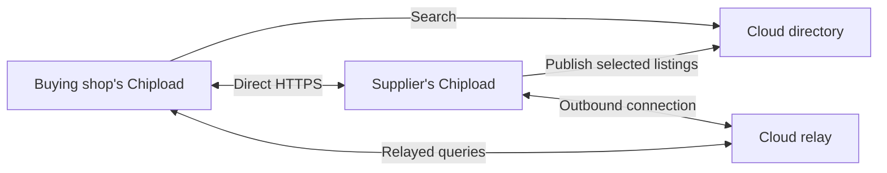

# Communication between Chipload instances

Status: portable federation workflow implemented. Listings, direct public instance queries,
the directory, geographic supplier search and the cloud relay service are
implemented. The managed outbound connector and runtime credential provider are
also implemented; see [CONNECTOR.md](CONNECTOR.md). Caller-scoped REST and hosted
Python use the [network queue](NETWORK.md). Separate cloud/connector packaging
and the real-identity multi-instance drill are documented in
[FEDERATION_CONTAINERS.md](FEDERATION_CONTAINERS.md).

## Implemented listing contract

Python projects can define `Listing`, `ListingField`, `ListingChoice`,
`SemanticRef` and `GeoPoint` objects. Listings belong to `Shop.listings`; optional
disclosed coordinates belong to `Site.public_location`. Each listing selects a
capability, workflow or offer and optionally a site. `visibility="public"`
exposes it through ordinary catalog/list/item discovery; `indexed=True` separately
opts it into directory publication. Both default to private/off.

`SemanticRef(namespace=..., version=..., term=...)` identifies an exact term.
Namespaces are bounded names, not URLs to fetch or proof of vocabulary ownership.
Each field binds a term to a target fact or initial-state input. Optional choices
translate exact semantic values to the shop's local values; unlisted strings are
not aliases. Public mappings are themselves public, participate in the public
revision, and cannot reference hidden catalog items. Private listings do not
alter that public revision. Old artifacts without listings or coordinates retain
their canonical serialization.

Use `ListingQuery` and `ListingInput` from `chipload.listings` with
`shop.evaluate_listing(listing_id, query)` in Python, or POST
`/v1/shops/{shop}/listings/{listing}/evaluate` with a `shop_id`, `listing_id` and
`query` envelope. MCP's existing `discover_shop` accepts `listing_evaluate` with
the same arguments. `/v1/sdk` includes the schemas. An exact profile and
`expected_revision` are required. Translation and evaluation use one publication,
observation and evidence snapshot. Unknown semantic bindings return `unknown`,
changed public revisions return 409, and missing/private/withdrawn listings
return 404. Evaluation retains the existing business, evidence and privacy rules.

`examples/federation_shops.py` supplies two material sellers, milling, heat
treatment and document review projects. These are fictional, simulated examples;
their vocabulary and policies are not engine defaults. The nearby seller has a
100-piece minimum and the farther seller accepts small lots. Availability remains
unknown without a fresh external observation when readiness is requested.

```sh
uv run python -m examples.federation_shops
uv run --extra server python -m unittest discover -s tests -p 'test_listing*.py' -v
./scripts/build-worker
CHIPLOAD_WORKER_TESTS=1 uv run --extra server python -m unittest discover -s tests -p 'test_listing_worker_live.py' -v
```

The ordinary checks cover mapping identity, public-data privacy, publication
guards and REST/MCP/Python equivalence. The opt-in check builds all five exported
projects in source containers and queries them from hosted Python. It also runs
in the CI Python live profile. These checks do not exercise a directory or relay.

The first checkpoint passed 551 ordinary checks (76 opt-in skips), 16 selected
live worker/agent checks with no skips, and all reference/process example suites.
The five listing projects passed 20 technical/business acceptance cases.

## Implemented direct instance protocol

Generate an ID once with `uv run python -c 'import uuid; print(uuid.uuid4().hex)'`
and store it as `instance_id` in the operator-owned server configuration. Preserve
this 32-character hexadecimal ID in configuration and backups across restarts,
host moves and certificate changes. Apply configuration changes while the API
is stopped and recreate its container after replacing a mounted file. Existing
configurations omit this field and keep federation routes disabled.

`GET /.well-known/chipload` identifies the instance. `POST /v1/peer/query` accepts
a `chipload-peer-1` envelope containing destination `instance_id`, unique
`request_id`, a deadline within 30 seconds and a typed `query`. Actions are
`catalog`, `listing_evaluate`, `evaluate` and `variables`. The existing admission,
Host/Origin and public-data policies apply; replies use `no-store`.

Replies echo instance/request identity and carry a public result, public revision
and publication generation selected with observations/evidence in one database
snapshot. Optional `expected_generation` fences rollback or republishing even
when public catalog bytes stay identical. Evaluation and variable queries also
require the public revision; listing queries carry it in `ListingQuery`.
Wrong/disabled instances and unpublished shops return 404, changed publication
guards return 409, and an expired in-flight query returns 408.

Trusted conventional Python clients use `PeerClient` from `chipload.peer`:

```python
from chipload.peer import PeerClient

peer = PeerClient("https://supplier.example", instance_id)
peer.descriptor()
publication = peer.catalog("supplier")
result = peer.evaluate_listing("supplier", listing_id, query,
                               expected_generation=publication.generation)
```

Here `query` is a `ListingQuery` built from published terms and
`publication.revision`. `peer.query()` also accepts `PeerEvaluate` and
`PeerVariables` from `chipload.peer_model`. OpenAPI and `/v1/sdk` include the
envelopes. The client verifies response identity, action, target, revision,
generation when pinned, and actual catalog content digests. Public queries
carry no local bearer token and require no cloud service.

Each HTTPS attempt runs in a disposable trusted process with CPU/memory/byte
limits and a wall deadline covering DNS, TLS and reads. Every resolved address
is validated; the socket connects to that exact address with the original TLS
hostname. Defaults permit public addresses on port 443. Operator-owned
`EgressPolicy` can add public ports, exact private HTTPS origins and a CA bundle
for LAN peers. Link-local metadata, multicast and unspecified addresses remain
blocked. Redirects, proxies, encoded responses, duplicate JSON keys, oversized
output and credential echo are rejected; HTTP attempts are not replayed.
These process limits contain trusted transport code, not hostile tenant code.
Hosted shop programs retain their existing network boundary and compose remote
reads through the [caller-owned network queue](NETWORK.md).

`test_peers.py` and `test_federation_wire.py` passed 18 checks using actual TLS
listeners, independent repositories and the supervised service process. They
cover generation/withdrawal fences, duplicate local shop IDs, altered replies,
TLS trust/name failures, DNS/address restrictions, hostile responses and a real
stalled DNS process killed by its parent deadline. Run them with
`uv run --extra server python -m unittest discover -s tests -p 'test_peers.py' -v`
and the same command with `test_federation_wire.py`.

The direct checkpoint also passed 569 ordinary checks and the existing reference
and process examples. `test_peer_tls_live.py` exercised a real isolated source
build, Keycloak-authorized publication, peer queries through the packaged TLS
gateway, restart with the same instance ID and rejection after withdrawal. The
existing runtime and both TLS lifecycle checks passed against the same images.
The peer container check is included in the CI `tls` profile; run it locally
with `CHIPLOAD_TLS_TESTS=1` and the unittest command above selecting
`test_peer_tls_live.py` after building worker, runtime and TLS images.

## Implemented cloud service

`chipload.cloud` serves the optional directory and public-query relay. It has
its own operator-owned `CloudSettings`, stable `directory_id`, private SQLite
state and paired request-accounting database. It uses the existing Keycloak JWT
verifier and Host/Origin/proxy policies. Its `OwnerBinding` entries bind a
verified subject to an instance ID, with independent `advertise` and `connect`
permissions. Shop grants on a local Chipload API do not grant cloud ownership.
Change bindings while stopped and restart the service; revoked owners' existing
advertisements disappear from search.

The `identity` field uses `ServerSettings` for issuer, audience, JWKS trust,
hosts and database location. Its `bindings` must be empty and `instance_id` must
be omitted; cloud ownership uses the separate fields above. Generate a directory
ID once and preserve it with the state. Keep configuration owner-only and use an
absolute database path in a dedicated private directory. Initialize fresh state
explicitly, then serve behind an operator-configured HTTPS gateway:

```sh
uv run --extra server python -m chipload.cloud init --config /absolute/private/cloud.json
uv run --extra server python -m chipload.cloud serve --config /absolute/private/cloud.json
```

The listener defaults to `127.0.0.1:8090`. Initialization is not a recovery
command: restore the directory, accounting and admission files together if state
is lost. Serving refuses missing accounting state. A private process lock enforces
one serving process per state volume, since relay sessions are in memory. This
checkpoint supplies the service and conventional Python client. The separate
[connector daemon](CONNECTOR.md) handles outbound sessions and publication
refresh. The [container launcher and disposable enrollment drill](FEDERATION_CONTAINERS.md)
package those services separately. These commands alone do not qualify a public deployment.

| Route | Contract |
| --- | --- |
| `GET /.well-known/chipload-cloud` | Public protocol and directory identity. |
| `POST /v1/suppliers/search` | Public `SupplierSearch`, returning a `SearchPage`. |
| `GET /v1/instances/{instance}/publications/{shop}` | Owner reads the current publication receipt, including a withdrawal tombstone. |
| `PUT /v1/instances/{instance}/publications/{shop}` | Owner submits an `Advertisement` with expected directory version and an exact public catalog. |
| `POST /v1/instances/{instance}/publications/{shop}/withdraw` | Owner withdraws with expected version and a unique request ID. |
| `POST /v1/instances/{instance}/relay/{open,poll,complete,close}` | Owner establishes a fenced outbound session, receives public queries and completes deliveries. |
| `POST /v1/relay/query` | Public fixed peer-query envelope; waits for the connected destination's reply. |

Advertisements carry a 30–300 second lease, source observation time, generation
and revision. Before accepting a new version the cloud fetches the source
catalog through its direct HTTPS origin or connected relay and verifies the
same generation/revision. A source must have an operator-owned instance binding;
public callers cannot enroll identities. Successful write retries return the
original receipt without extending its lease. CAS versions and persistent
withdrawal tombstones reject delayed writes and generation rollback after
restart. Only public, explicitly indexed listings enter the search index.
The advertisement JSON limit is 2 MiB; oversized catalogs are rejected rather
than partially indexed. Global and per-instance publication/listing/field/choice
caps bound storage; exhaustion returns a refusal without replacing the old head.

Search matches an exact versioned profile and semantic fields/choices on the
same offering. Heat treatment and nonphysical services use the same index.
Literal quantity and other business inputs only establish that a field exists;
the candidate must be evaluated at its supplier with those inputs. Search
returns source generation/revision and expiry for that fresh query. It never
asserts stock, business acceptance or equipment availability.

Geographic results use disclosed site coordinates and reported accuracy. Distances
are straight-line meters, with uncertainty reported separately. A radius requires
an origin; geographic searches exclude missing locations unless requested, and
never rank them as zero distance. Searches without an origin can discover
unlocated services and return no distance. Pages contain at most 100 candidates; cursors bind the query and
live advertisement snapshot. A changed snapshot returns 409 so callers can
restart the search. Search covers this directory's active advertisements only.

The relay carries the four public peer actions, not arbitrary HTTP or remote
authoring. Sessions have persistent monotonic epochs and server-generated
delivery IDs. Replacement, disconnect, expiry and restart fence old replies.
Pending work is bounded globally, per destination and per requester; there is
one long poll per session and no offline queue. Successful polls and completions
renew the session lease; `RelaySession.expires_at` reports the initial lease.
Polls accept `wait_seconds` from 1–10 (default 5); the Python client reserves
three seconds of its transport budget for authentication and network overhead,
and requires a budget of at least four seconds for polling. Queries retain their original
request identity and deadline of at most 30 seconds. Destination errors and
transport failures are refusals, never a fabricated `unsupported` domain answer.
Relay completion bodies are capped at 3 MiB, smaller than direct reply limits.

`CloudClient` from `chipload.cloud_client` validates directory/search/receipt and
peer response identities using the same bounded HTTPS transport as `PeerClient`.
Its optional token provider is used only for owner operations at the fixed cloud
origin. Search and public relayed queries send no enrollment bearer token.
`search(SupplierSearch(...))`, `catalog(instance_id, shop_id)` and
`evaluate_listing(instance_id, shop_id, listing_id, query, expected_generation=...)`
provide conventional Python access. Isolated hosted shop programs use
`shop.network(...)` and caller-owned receipts through the trusted connector;
they receive no sockets or enrollment credentials. See [NETWORK.md](NETWORK.md).

Focused tests are `test_directory.py`, `test_relay.py`, `test_cloud.py` and
`test_cloud_client.py`, run with the ordinary unittest command above. They cover
ownership/audience denials before body parsing, independent owner permissions,
lease expiry, replay/withdrawal, same-offering geography/material matching,
pagination fences, queue/session limits and restart. Actual HTTPS client tests
show the nearest seller rejecting a small lot, a farther relay-only advertisement
accepting it, equal direct/relayed evaluations, and direct queries surviving a
cloud outage. Their outbound receiver is a test fixture; the managed connector
has separate TLS tests in `test_connector.py` and `test_connector_auth.py`.
The combined real-identity multi-instance container drill is
`test_federation_live.py`; run it with the
[container instructions](FEDERATION_CONTAINERS.md).

## Two ways to reach the same shop

A Chipload instance can contact another instance directly over HTTPS. A cloud
service provides a directory for finding shops and an optional relay for
reaching them. Directory use does not require relayed communication; a shop can
discover a supplier in the cloud and then use its direct endpoint.



The supplier initiates its relay connection, allowing an instance with no public
inbound listener to participate. The directory and relay can share a deployment
while retaining separate responsibilities: the directory indexes advertisements;
the relay carries bounded requests to an enrolled instance. A self-hosted shop
can use direct peers, one or more configured directories, or both. The shop
instance remains authoritative for its current publications and decisions.

The first complete network workflow covers public discovery and capability or
business-rule evaluation. It uses the existing public service contracts. Remote
authoring and privileged operations require their own explicit grants and a
subsequent authenticated communication contract. RFQ intake, orders, purchasing
and inventory management remain outside this phase.

## What a supplier search means

Support both material supply and outsourced processing as distinct search
intents. A material distributor might sell 6061-T6 aluminum plate. A processing
shop might accept customer-supplied 6061-T6 plate for milling. Publishing one
claim must never imply the other. These meanings live in versioned, namespaced
discovery profiles and shop code; the engine matches declared terms and rules
without branching on manufacturing or supplier types.

An offering associates a specific site and capability or offer with the facts
relevant to that offering. Material, service and site filters must match that
same offering. Flattening all of a company's materials and services into global
tags would incorrectly match a material accepted only at a different facility
or for a different process.

| Search information | Meaning |
| --- | --- |
| Requested offering | A supplied product or a processing/service capability, with an explicit vocabulary version. |
| Material | Exact specification/grade and, when relevant, temper, condition, form and dimensions. |
| Technical facts | Required process, envelope, tolerances and relevant evidence or certification. |
| Business facts | Quantity with units, prototype/production conditions, customer prerequisites, documentation and delivery constraints. |
| Geography | Search origin, radius and the supplier site performing or supplying the offering. |
| Freshness | Publication revision, advertisement expiry and timestamps for any changing observations. |

Local IDs remain useful inside a shop. Cross-shop matching needs shared semantic
references; identical strings in unrelated catalogs do not establish equivalence.
Profiles define reference terms and fact mappings, and shops explicitly bind
them to their own catalogs and capability inputs. Unknown terms remain unknown.
Aliases and substitutions require explicit mappings; a search for a particular
grade must not silently broaden to a material family. Profiles are bounded data,
not remotely downloaded Python plugins.

For example, a mill seeking 6061-T6 plate would:

1. Search material-supply offerings within a radius of its chosen location,
   including required stock form, dimensions, quantity and documentation.
2. Receive candidate supplier sites, their advertised matching facts, approximate
   distance, publication reference, freshness and available communication routes.
3. Query shortlisted suppliers directly or through the relay using the full
   technical and business facts.
4. Receive `supported`, `unsupported`, `conditional` or `unknown`, with reasons
   and freshness, from each supplier's current model.

The directory produces candidates, not a guarantee of acceptance. Supplier
evaluation must still apply business rules: a nearby supplier with a minimum
quantity above the request cannot be reported as a supported match. The client
can evaluate the next candidate when an earlier one fails. Results retain both
distance and outcome; conditional and unknown results stay visibly distinct.
Use distance ascending within a selected outcome group, with a stable identity
tie-breaker. A bounded shortlist must not claim to find the globally nearest
acceptable supplier if further candidates remain unevaluated.

Distance initially means straight-line geographic distance, with units and
coordinate accuracy reported. It does not imply driving distance, freight cost
or delivery time. Shop authors choose whether to publish exact coordinates or
an approximate service location. Missing location is unknown and cannot rank
as zero distance. Unknown or approximate locations need explicit search policy.

Material capability, material supply and current availability are separate
claims. Stock or delivery observations can come from an ERP with source and
freshness preserved. Missing or stale stock data stays unknown; Chipload does
not become the inventory ledger or reserve material during discovery.

## Shop definitions and publication

The shop's Python project owns its discovery offerings, semantic bindings,
site locations and business rules. Building validates references, units,
profile versions, disclosure choices and bounds alongside the existing shop
model. A publication selects the matching discovery projection from that same
build; the directory does not have an independently edited copy of shop truth.

Indexing is an explicit opt-in, separate from public API visibility. The
projection contains only approved public fields. Source, private equipment,
private business conditions and secrets stay out of advertisements. Incomplete
public conditions remain incomplete; search cannot probe hidden allowed values.

Each advertisement identifies the instance, local shop, offering, site and
publication, plus its generation, issue time and expiry. Publication updates
replace the advertised generation; withdrawal removes it. A connector renews
short-lived leases while the corresponding publication remains current.
The directory rejects replayed generations and expired leases. It retains enough
withdrawal/version state to prevent delayed updates from resurrecting a listing.

Disconnection cannot provide instant global withdrawal. Results expose their
age and expiry, and stale entries leave the searchable index after the bounded
lease. Fresh supplier evaluation checks current publication even when discovery
used a still-valid older listing. A request pinned to an obsolete publication
returns a conflict so the client can refresh rather than combine revisions.

## Identity and trust

Use a stable instance identity separate from its current host name and relay
connection. A remote shop identity is the pair `(instance_id, shop_id)`; two
instances can legitimately use the same local shop ID. Sites and offerings are
scoped to that pair. Changing hosts or keys must preserve identity through an
explicit authenticated transition.

Directory enrollment binds an authenticated owner to an instance and its
advertisements. Direct endpoints need proof of endpoint control, while
relay-only instances prove control through their enrolled outbound connection.
Neither form of enrollment verifies that a physical manufacturing claim is true.
Registration, route replacement, key rotation and withdrawal need audit records,
version checks and revocation behavior. A search response cannot enroll itself
as a trusted issuer or grant access to a local shop.

Public requests use the destination's existing anonymous discovery policy.
For future private calls, the destination controls accepted identities and grants.
Keycloak deployments need not share a realm. Relay enrollment credentials and
shop access credentials have separate audiences and permissions. Resource-bound
tokens follow [OAuth resource indicators](https://www.rfc-editor.org/rfc/rfc8707.html)
and the [OAuth security BCP](https://www.rfc-editor.org/rfc/rfc9700.html);
a local or relay token must not be forwarded to a newly discovered supplier.
OpenBao holds connector credentials and keys outside shop-authored code.

## Direct and relayed requests

Both routes dispatch the same typed public operation to the destination's
existing services. The request carries destination identity, request ID,
protocol version, operation, bounded arguments, deadline and an optional
expected publication. The response carries the matching request/destination,
publication, result or structured error. Transport failures remain distinct
from domain outcomes: a disconnected supplier is not an unsupported process.

Direct mode connects to a verified HTTPS endpoint. Relay mode sends to an
enrolled destination identity over its authenticated outbound session. The
connector forwards only the allowed public operations to its configured local
service. A relay cannot select arbitrary URLs, HTTP methods, local ports,
headers or privileged SDK operations. It is not a general network tunnel.

Each destination has bounded request bytes, response bytes, in-flight work,
deadlines and queue capacity. The relay applies separate requester and destination
budgets so one client cannot monopolize a supplier. Expired or disconnected
requests fail explicitly; no unbounded offline backlog is retained. Connection
replacement fences the old session, and replies must match both destination
and request identity. Queries have bounded retries; future mutations must retain
durable idempotency and ambiguous-outcome handling across route changes.

In the first public-query protocol, TLS protects each connection and the relay
operator can see requests and responses. That version trusts the relay for
routing and result integrity; TLS on each leg does not establish end-to-end
origin proof or confidentiality. Sensitive/private relayed queries need a
separate reviewed end-to-end transport and identity design before they are enabled.
Search and relay logs should avoid retaining query bodies or precise customer
locations by default.

Untrusted endpoints introduce server-side request-forgery risk. The network
component must validate addresses at connection time, bind the connection to
the validated resolution, verify the HTTPS name, disallow redirects and apply
egress restrictions. Public directory routes cannot reach loopback, private,
link-local or cloud-metadata addresses. Explicit operator-configured LAN peers
are a separate policy. These controls follow
[OWASP's SSRF guidance](https://cheatsheetseries.owasp.org/cheatsheets/Server_Side_Request_Forgery_Prevention_Cheat_Sheet.html).
Discovery cannot weaken the existing isolated Python worker's network boundary.

## REST and code interfaces

Provide the directory search and peer query services as documented REST APIs
with bounded pagination and structured errors. Search pages identify the index
snapshot, ranking and filters so updates do not silently mix result sets.
Results expose the search scope, truncation and freshness; one directory cannot
claim complete coverage of all Chipload shops.

The Python client composes search, candidate inspection and supplier evaluation.
Hosted agent programs invoke those same caller-scoped services through the
trusted SDK path; they do not obtain arbitrary outbound sockets or connector
secrets. Preserve the four code-oriented MCP tools. The network feature adds
Python operations and independent REST contracts, not a tool per supplier action.

A separate network connector owns outbound communication and enrollment.
The API, source worker and build broker keep their current responsibilities.
Package the connector and cloud directory/relay independently so running a shop
does not require operating or joining a cloud service.

## Implementation sequence and acceptance

1. **Publication and matching contract.** Add versioned discovery profiles,
   per-offering site/material relationships, geographic disclosure and an
   opt-in public projection. Validate raw-material supply, machining, heat
   treatment and a nonmanufacturing service through the same abstract engine.
   Test exact material distinctions, unknown facts, quantities, business rules,
   private fields, locations and deterministic distance ordering.
2. **Direct peers.** Add stable remote identities, descriptor/control checks,
   constrained network calls and Python/REST composition. Two independent
   instances must discover and evaluate each other with no cloud dependency.
   Test wrong identity, invalid TLS, redirects, DNS changes, private-address
   targets, timeouts, response bounds and duplicate local shop IDs.
3. **Cloud directory and outbound relay.** Add authenticated enrollment,
   publication leases, bounded search and request delivery over outbound
   sessions. Test ownership, replay, withdrawal, expiry, reconnection fencing,
   destination isolation, overload and visible relay trust boundaries.
4. **Container end-to-end workflow.** Run a buying shop, a directly reachable
   supplier, a supplier with no public listener and the cloud service. Search
   for a material-specific offering, rank sites, reject the closest candidate
   on its business rule and obtain the next supplier's evaluation. A conventional
   REST client and a Python agent must get equivalent results over both routes.
   Disconnect the relay and prove direct communication still works; withdraw a
   publication and prove fresh queries and directory lease expiry respect it.

The phase is complete when that full workflow and its failure cases run from
documented container commands. Public cloud deployment, provider operations and
actual supplier qualification require their own deployment evidence.

## Portable workflow checkpoint — 2026-10-21

The combined real-identity drill passed all assertions: three independently
published Python shops; TLS Keycloak/OpenBao enrollment; narrow workload ACLs
and bootstrap-root retirement; nearest-supplier quantity rejection; equivalent
REST/MCP selection using direct and relayed reads; private supplier topology;
withdrawal; lease expiry; and direct dispatch after cloud outage and connector
restart. The separate cloud packaging check verified TLS, restricted mounts and
processes, restart identity/accounting persistence and missing-store refusal.

The ordinary suite ran 713 tests successfully with 80 opt-in checks skipped.
The runtime live test and both TLS lifecycle tests passed separately. Launcher
checks also passed on Python 3.12. Public deployment, actual supplier
qualification, cloud HA, cloud certificate automation and off-host cloud recovery
remain outside this portable workflow.
