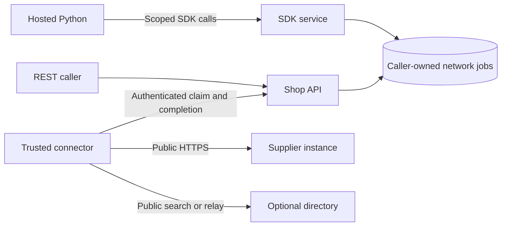

# Federation from REST and hosted Python

A caller can queue a public peer query or supplier search through its shop's
trusted connector. REST and `chipload.client` use the same service, permissions,
queue and receipts. Hosted Python keeps its isolated network namespace; neither
shop code nor its SDK service receives connector credentials or outbound sockets.



The connector has no repository mount. Its own service identity can claim only
jobs for explicitly granted shops. Job schemas expose fixed public actions and
source/directory identities. They have no authentication, arbitrary-header or
operator-egress-policy fields. Public direct discovery and cloud REST
search remain independently usable without this queue.

## Permissions and connector configuration

Grant an agent `network:query` for each shop whose queue it may use, plus the
usual `code:run`/`code:read` grants for hosted Python. The `shop:operate` Keycloak
role permits that action only when an explicit shop grant also exists. Existing
bindings do not automatically gain new actions.

Provision a separate connector service account with the `shop:connect` client
role and an explicit `network:dispatch` grant. That role confers no source,
operation or agent-program permissions. A local binding looks like:

```json
{"subject": "connector-service-account-subject", "grants": [
  {"shop_id": "shop", "actions": ["network:dispatch"]}
]}
```

New TLS deployments grant their default authoring agent `network:query` and
exclude `network:dispatch`. Hosted SDK programs cannot invoke connector claim or
completion operations even if the submitting identity has an administrative
grant. HTTP network routes check the appropriate grant before parsing their body.

Add `dispatch` to the [connector configuration](CONNECTOR.md). It contains a
private `credentials` directory and a `WorkloadIdentity` named `identity`, with
the same OpenBao/Keycloak fields documented there. Its `trust.resource_url` must
be the local `source_origin` plus `/mcp`; its subject must match the local
connector binding. Its policy must explicitly permit private local API, issuer
and OpenBao origins, and trust their TLS certificates. Use a dedicated OpenBao
KV-v2 record and AppRole for this local client, separate from cloud enrollment.
Do not store unrelated credentials in that record.

The existing `shops` list scopes both local dispatch and publication. An instance
can use `dispatch` with an empty `clouds` list for direct queries only. Set
`query_policy` to the operator-owned `EgressPolicy` for direct remote queries;
this is separate from the local source and credential policies. It defaults to
public HTTPS on port 443. Exact LAN exceptions require explicit configuration;
metadata/link-local destinations remain blocked.

A buying shop can configure a public directory without enrolling or obtaining a
cloud credential:

```json
{
  "id": "suppliers",
  "origin": "https://directory.example",
  "directory_id": "22222222222222222222222222222222",
  "advertise": false,
  "relay": false,
  "query": true
}
```

This is one element of `clouds`. Optional `policy` configures its public HTTPS
transport. Publishing or receiving relayed requests still requires the separate
cloud identity and credential directory described in `CONNECTOR.md`. Set
`query=false` on an enrollment-only link to exclude it from queued outbound reads.

## REST contracts

| Route | Permission and behavior |
| --- | --- |
| `POST /v1/shops/{shop}/network/queries` | `network:query`; submit a `NetworkSubmit`, returning a receipt and HTTP 202. |
| `GET /v1/shops/{shop}/network/queries/{id}` | `network:query`; read only your own receipt. |
| `POST /v1/shops/{shop}/network/queries/{id}/cancel` | `network:query`; cancel only your own pending read. |
| `POST /v1/shops/{shop}/network/claim` | `network:dispatch`; claim one job, or return `{"lease":null}`. |
| `POST /v1/shops/{shop}/network/complete` | `network:dispatch`; complete one currently owned, fenced delivery. |

Submit `shop_id`, a stable `request_key`, an absolute UTC-aware `deadline` within
30 seconds, and one typed `query`:

- `direct`: HTTPS `origin` and an existing `PeerRequest` in `request`.
- `relay`: configured `cloud` ID and a `PeerRequest` in `request`.
- `search`: configured `cloud` ID, expected `directory_id`, and a `SupplierSearch`
  in `query`.

Peer envelopes retain their request ID, destination identity, publication guards
and deadline. Outer and peer deadlines must agree. A search response must match
the expected directory, query hash, profile and candidate freshness. Unknown cloud
IDs or disabled query links fail; they never fall back to another destination.
OpenAPI and `/v1/sdk` include the submission and receipt schemas.

Receipts use `queued`, `running`, `succeeded`, `failed`, `cancelled` and `expired`.
Transport errors carry a bounded status/code. They are distinct from successful
transport carrying a supplier's `unsupported`, `conditional` or `unknown` domain
answer. Cancellation fences completion but cannot undo a public read already
received by another service. Closed or expired deliveries reject late replies.
A lost connector delivery is never reclaimed or replayed; its deadline expires.

A receipt records a historical read, including the supplier's generation,
revision and evaluation/expiry timestamps. Reading it does not contact the
supplier or assert current support. Use a new key and fresh publication guards
for a fresh query. Exact retries with the original intent return the same receipt;
reusing its key with changed inputs returns 409. Keep generated envelopes and
absolute deadlines in run inputs when an exact retry must survive program loss.
Terminal history is retained for at least one hour and pruned on later admission;
a pruned, expired intent cannot run again.

## Python composition

The four existing MCP tools stay unchanged. A program submits and inspects a job
through its selected shop:

```python
import time
shop = client.shop(inputs['shop_id'])
job = shop.network(inputs['network_query'], deadline=inputs['deadline'],
                   request_key=inputs['request_key'])
while True:
    receipt = shop.network_result(job['id'])
    if receipt['state'] not in ('queued', 'running'):
        break
    time.sleep(.2)
result = receipt
```

Use `shop.network_cancel(id)` to cancel a job. Programs can also compose typed
`DirectRead`, `RelayRead` and `DirectoryRead` objects from `chipload.network_model`.
These models and the SDK service require only the core SDK dependencies. A long
query can be inspected from a subsequent run; it has its own absolute deadline.
Existing program output, call-count and execution-time limits still apply, so
return the relevant portion of a large catalog rather than an entire raw result.

For supplier selection, search first, then evaluate candidates with their exact
profile, revision and generation plus the complete technical and business inputs.
A nearby candidate can fail a quantity rule; evaluate the next one. Preserve
conditional/unknown answers and timestamps rather than treating directory
membership as acceptance or current stock.

## Capacity, storage and verification

Pending jobs are capped at 32 per instance, 16 per shop and eight per verified
subject across its shops. At most four jobs run per instance and two per subject.
The connector shares four execution slots with incoming relayed reads; idle
relay polls do not consume an execution slot. Empty local polls do not consume a
mutation allowance; successful claims do. A fenced completion uses its existing
reservation and HTTP allowance, so spent mutation credit cannot discard an
already-performed read. Ordinary ingress and submission budgets still apply.

Each intent is limited to 128 KiB. Result payloads are capped at 3 MiB minus
128 KiB, reserving room for credentials, policy and completion framing. Pending
work reserves its maximum result size before admission. Intent/result budgets
are 128 MiB per instance, 64 MiB per shop and 32 MiB per subject, with at most
2,048 retained rows. Capacity refusals do not create jobs or imply a supplier
rejection. These are payload budgets; SQLite journals and indexes also use disk.

Repository schema 12 adds the queue in an atomic migration. Preserve the paired
repository/admission stores and use matching recovery tools. Backups include
private query criteria and historical results. Expired reads restored from a
snapshot cannot be dispatched again. Connector credentials remain outside those
repository mounts and require their own operator custody.

`test_network.py` covers ownership, exact retries, result binding, cancellation,
expiry, concurrent claims, capacity, migration and paired recovery.
`test_network_transports.py` uses real HTTPS for direct-only operation, public
cloud search without enrollment, relay evaluation and withdrawal. The opt-in
`test_network_live.py` uses actual Python/SDK containers to verify mediated reads,
blocked sockets, absent database/credential mounts and unavailable dispatch RPCs.
It runs in the CI `python` profile with `CHIPLOAD_WORKER_TESTS=1` locally after
rebuilding the worker. Federation container packaging and the combined
multi-instance demonstration with real Keycloak/OpenBao remain separate work.
