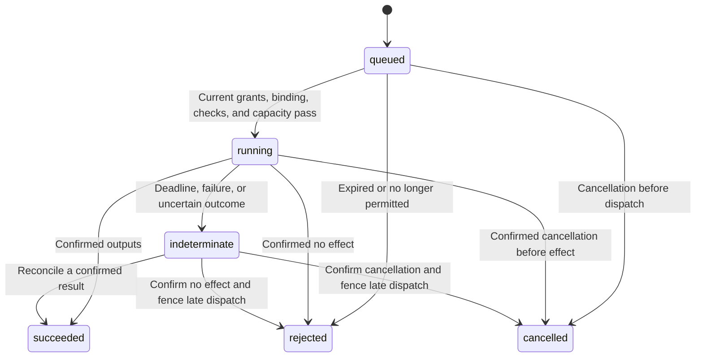

# Callable shop operations

A shop can publish typed call contracts alongside its capabilities and business
rules. Authorized clients submit calls through REST or MCP, then inspect durable
execution records. The separate executor supplies simulated adapters and a
[bounded HTTPS adapter with scoped OpenBao credentials](ADAPTERS.md). Equipment,
human-task systems, and ERP products need bridges implementing the receiver
contract and their own qualified acceptance/recovery procedures.

The example [callable_shop.py](../examples/callable_shop.py) defines four calls:
document review, sample manufacture, inspection, and an outside process. Its
prototype policy restricts engagement and integer quantities, and its machine
check restricts length. These are fictional example policies. All four adapter
results are explicitly simulated. They do not establish equipment qualification,
human approval, or acceptance by an outside business.

## Author a contract

`Shop.operations` contains `ShopOperation` objects. Each declares:

- A permanent operation ID, name, visibility, and description.
- A logical adapter alias and command, with `read` or `write` effect and a stated
  effect description. These describe the intended action; they do not grant access.
- Named inputs and outputs: text, boolean, or quantity with explicit units.
  Required fields must be present, undeclared fields are rejected, and quantities
  must have compatible dimensions. Convertible units retain their supplied values.
- Resource IDs used by the operation. Claims exclude other operations using those
  IDs in the same shop, including reads. Operators must account for equipment
  shared across shops; resource names alone do not establish global equipment locks.
- Capability or workflow checks, including selected input names, initial state,
  and minimum evidence. Technical constraints and business rules use the same
  evaluator. Checks default to qualified evidence and run for current readiness.
- A dispatch deadline of 1–300 seconds, default 30.

At admission and again before dispatch, every check must be `supported` using
the current observation snapshot and service clock. `conditional`, `unknown`,
and `unsupported` all prevent dispatch. Referenced resources must be active,
and the operation's resource list must cover every resource used by its checks.
The combined checks must fit the model's evaluation budgets. A check's initial
state is an authored assumption, not an observation of a physical part; use
timestamped observations where current evidence is required.

Only public operation metadata, effects, field contracts, and timeout appear in
anonymous discovery. Adapter aliases, commands, resource references, internal
checks, binding status, and execution records require authorization. Authors
remain responsible for information deliberately written into public descriptions.

## Configure authority separately

Publication does not enable an adapter. The operator provisions an `AdapterBinding`
against an exact published model and operation, choosing a trusted adapter ID
and an explicit `simulated` or `live` mode. A subsequent model publication requires
a matching binding. Generation checks protect binding edits from stale writers.
This is local operator authority and can be delegated to an appropriately trusted
agent; it is not a mandatory human-approval workflow.

For example, save this as `.local/machine-binding.json`, replacing the digest
with the `model_sha256` from authorized operation inspection:

```json
{
  "shop_id": "callable-example",
  "operation_id": "make-sample",
  "model_sha256": "REPLACE_WITH_PUBLISHED_MODEL_SHA256",
  "adapter_id": "machine",
  "mode": "simulated",
  "enabled": true
}
```

```sh
uv run --extra server python -m chipload.local --database .local/chipload.db \
  bind-operation .local/machine-binding.json --expected-generation 0
```

Bindings contain no credentials or connection URLs. Shop source cannot register
Python adapter implementations or change this authority through REST/MCP.
The executor registry is trusted infrastructure. HTTPS bindings also pin the
operator configuration in `adapter_sha256`; see [ADAPTERS.md](ADAPTERS.md). A
`live` binding alone does not provision a receiver or qualify its effects.

Keycloak's `shop:operate` role permits operation read/execute/cancel actions as a
ceiling. The subject must also have each action in an explicit shop grant.
`Grant.operations` optionally restricts that grant to named operations: omitted
or null permits all operations covered by the grant; an empty list permits none.
An operation and its action must match the same grant. Authoring permissions
do not imply execution permissions.

The executor rechecks operator-owned grants before dispatch and reloads its
settings between claims. It does not introspect Keycloak sessions for queued
work; token roles are checked at submission. Updating an operator grant requires
updating the configuration used by both API and executor and recreating both
containers when using individually mounted settings files.
Revocation after dispatch cannot undo an accepted external action.

## Submit and inspect

| REST endpoint | Python client | Grant |
| --- | --- | --- |
| `GET /v1/shops/{shop}/private/operations/{operation}` | `shop.operation` | `operation:read` |
| `POST /v1/shops/{shop}/operations/{operation}/executions` | `shop.execute` | `operation:execute` |
| `GET /v1/shops/{shop}/operations/{operation}/executions/{execution}` | `shop.execution` | `operation:read` |
| `POST /v1/shops/{shop}/operations/{operation}/executions/{execution}/cancel` | `shop.cancel` | `operation:cancel` |

Anonymous discovery uses the existing `operations` collection, through REST or
`discover_shop` with `page`/`inspect`. The private inspection response includes the published
contract, generation, model digest, binding generation, and whether it is enabled.

A REST submit body, or the equivalent arguments to `shop.execute` in Python:

```json
{
  "shop_id": "callable-example",
  "operation_id": "make-sample",
  "expected_generation": 1,
  "request_key": "sample-001",
  "mode": "simulated",
  "inputs": [
    {"name": "length", "value": {"value": "20", "unit": "mm"}},
    {"name": "quantity", "value": {"value": "3", "unit": "1"}},
    {"name": "engagement", "value": "prototype"}
  ]
}
```

REST submission returns 202 and an execution record. MCP programs use
`shop.execution(operation_id, execution_id)` and `shop.cancel(operation_id, execution_id)`;
REST read/cancel take those IDs from the path. Execution results are private to subjects with the appropriate shop
and operation grant, not necessarily restricted to the original requester.

Persist and reuse the same request key and exact payload after a lost response.
Within a shop and verified subject, that retry returns the same record even
after publication changes. A different payload with the same key returns 409.
A new key describes new work and can cause another effect. Request identities
and history are retained; there is no automatic deletion or key recycling.

## States, cancellation, and recovery



Queued work expires after five minutes. Dispatch records an immutable request,
publication, binding, and claim before invoking the adapter. If the executor
dies, an expired running call becomes `indeterminate`; it is never automatically
sent again. Uncertainty retains its execution capacity and resource locks.

Cancellation before dispatch prevents the effect. After dispatch it sets
`cancel_requested`; it does not claim the equipment stopped. An adapter may
already have completed successfully. Deadlines fence result commits but do not
stop a physical process or terminate an arbitrary adapter implementation.

Adapters receive a stable execution ID and an intent digest covering request,
model, and binding. They must durably deduplicate accepted effects and reconcile
using that identity. A rejected/cancelled result asserts both that no effect
occurred and that no late effect can occur. An absent receiver record alone is
insufficient proof. Partial acceptance or invalid outputs remain indeterminate.
Only validated successful output matches become a successful execution record.
Raw adapter errors are not returned to clients.

The simulator stores its receipt in the same repository transaction that checks
the claim and deadline. Reconciliation uses that receipt or a revoked claim
under the same writer lock to establish the outcome. This gives the simulator
a provable boundary; it does not provide universal exactly-once physical effects.

Repository schema 7 preserves bindings, jobs, simulation receipts, and resource
locks. Backups reject queued, running, or indeterminate operations. Before backup,
stop new submissions, settle/cancel queued work, reconcile uncertain results,
and stop separate executors. Restoring a database cannot roll back equipment or
an ERP. Recovery of external receiver ledgers remains part of each real adapter's
integration design; never replay old effects merely because of a restore.

## Run the simulator

Use private files owned by the deployment user, mode 0600. The executor's settings
require `database` and explicit `bindings` (subject/shop grants); other API
settings are ignored. Use the same grants and paired
repository as the API. When running on the host alongside the container API,
set `database` to the host's absolute path to `state/data/chipload.db`; the API's
container path `/data/chipload.db` is different. Keep grants synchronized.

For the `machine` binding above, `.local/simulators.json` contains:

```json
{
  "adapters": [
    {"id": "machine", "outputs": [{"name": "completed", "value": true}]}
  ]
}
```

```sh
uv run --extra server python -m chipload.executor \
  --settings .local/executor.json --simulators .local/simulators.json --once
```

Omit `--once` to poll the queue and reconcile uncertain calls. This is a separate
trusted process. For a supervised container with no network, use
`scripts/executor --simulators` as described in [ADAPTERS.md](ADAPTERS.md). The
API and build workers never execute adapters. The HTTPS adapter runs each call
in a bounded child process and uses scoped OpenBao credentials.
`--once` reports whether it dispatched a call and how many outcomes it reconciled.

Each deployment/shop/identity scope defaults to 100 pending operations, one
running or indeterminate operation, 600 new calls per hour, 1,000 retained
records, and 128 MiB of operation payload capacity. Policy edits use the existing
local quota commands. Admission reserves request/binding bytes and two 64 KiB
result payloads, including the simulator receipt. These are payload limits,
excluding SQLite/index and audit overhead. Dispatch and reconciliation use bounded
rotating scans so unavailable adapters do not permanently block later jobs or
receipts. Exact
request retries do not spend job capacity twice; HTTP/mutation rate limits still
apply to every request.

The example's capability `Workflow` expresses prerequisites and feasibility.
The live test sequences four operation calls as a client; durable orchestration
between operation jobs is not implemented. Shop operations do not manage ERP
orders, purchasing, inventory ledgers, production plans, or invoices. Adapters
may exchange external references and timestamped observations while the ERP
remains authoritative for those business records.

## Verification

```sh
./scripts/build-worker
./scripts/build-runtime
./scripts/build-tls
CHIPLOAD_OPERATION_TESTS=1 uv run --extra server python -m unittest discover \
  -s tests -p 'test_execution_live.py' -v
```

The live test builds the actual Python project in the restricted worker, publishes
through an authenticated MCP client, and exercises four simulated operations
through verified TLS and real Keycloak tokens. Unit tests cover changing evidence,
resource exclusion, cancellation, lost completion, late dispatch fencing, durable
retry identity, authorization, quotas, migration, and recovery snapshots.
