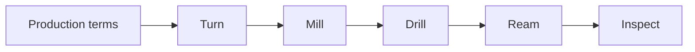

# Process offers and business rules

The [example library](../examples/process_shops/) contains **88 process examples
and one mixed shop**. Every shop has executable technical constraints, separate
prototype and production acceptance conditions, contextual business variables,
and acceptance cases. They use the same SDK and evaluator as the existing
[heat-treatment workflow](../examples/heat_treatment.py).

All limits, tooling, input grades, policies, observations, and evidence in this
library are **fictional test data**. A process name or a passing test does not
qualify equipment, certify a shop, or establish a manufacturing recipe. These
examples demonstrate how to encode shop knowledge and where missing knowledge
must remain unknown.

## Run, inspect, and export

From the repository with Python 3.12+ and `uv`:

```sh
# Lists every process ID, family, and example business model.
uv run python -m examples.process_shops --list

# Runs all 2,147 technical and business acceptance cases across 89 shops.
uv run python -m examples.process_shops

# Runs one shop or the mixed-process shop.
uv run python -m examples.process_shops swiss-turning
uv run python -m examples.process_shops mixed

# Prints exactly the public shop projection.
uv run python -m examples.process_shops milling-3axis --public

# Exports ordinary Python source plus acceptance cases for the isolated worker.
mkdir -p .local
uv run python -m examples.process_shops swiss-turning --export > .local/swiss-project.json
```

The runner executes trusted repository examples locally. The exported bundle
contains its imported Python modules and uses only the installed Chipload SDK
and standard library. It does not depend on the repository being mounted into a
worker. Follow [AUTHORING.md](AUTHORING.md) to save, build, publish, update, or roll
back that bundle; use its shop ID (`demo-swiss-turning` in this example).
The mixed bundle uses `demo-mixed-shop`.

## Coverage

Each ID below selects a runnable project and exportable source bundle.
The families organize examples; they are not a platform enumeration or a claim
that every specialty, process variant, or qualification is covered. A shop can
add a process in its own Python project without modifying Chipload.

| Family | Example IDs |
| --- | --- |
| Milling | `milling-3axis`, `milling-indexed`, `milling-5axis`, `horizontal-milling`, `gantry-milling`, `cnc-routing` |
| Holemaking | `drilling`, `deep-hole-drilling`, `boring`, `reaming`, `tapping`, `thread-milling`, `counterboring`, `countersinking` |
| Turning | `lathe-turning`, `cnc-turning`, `vertical-turning`, `swiss-turning`, `mill-turn` |
| Profiles and gears | `broaching`, `rotary-broaching`, `shaping-slotting`, `planing`, `gear-hobbing`, `gear-shaping` |
| Abrasive finishing | `surface-grinding`, `cylindrical-grinding`, `internal-grinding`, `centerless-grinding`, `honing`, `lapping`, `polishing`, `gear-grinding` |
| EDM | `wire-edm`, `sinker-edm`, `hole-edm` |
| Cutting | `band-sawing`, `cold-sawing`, `laser-cutting`, `tube-laser`, `waterjet-cutting`, `plasma-cutting`, `oxyfuel-cutting` |
| Forming | `press-brake`, `sheet-punching`, `stamping`, `plate-rolling`, `tube-bending`, `metal-spinning`, `forging`, `extrusion`, `wire-forming` |
| Joining and assembly | `arc-welding`, `laser-welding`, `resistance-welding`, `brazing`, `soldering`, `adhesive-bonding`, `mechanical-assembly` |
| Additive manufacturing | `material-extrusion`, `vat-photopolymerization`, `powder-bed-fusion`, `binder-jetting`, `material-jetting`, `directed-energy-deposition`, `sheet-lamination` |
| Casting | `sand-casting`, `investment-casting`, `die-casting` |
| Molding and composites | `injection-molding`, `compression-molding`, `blow-molding`, `rotational-molding`, `thermoforming`, `composite-layup`, `resin-transfer-molding` |
| Thermal treatment | `thermal-treatment`, `surface-hardening`; also the separate heat/cool/verify workflow linked above |
| Surface finishing | `anodizing`, `electroplating`, `powder-coating`, `wet-painting`, `passivation`, `abrasive-blasting`, `deburring` |
| Inspection | `coordinate-inspection`, `optical-inspection`, `nondestructive-testing` |
| Mixed shop | `mixed` |

The Python definitions live in
[machining.py](../examples/process_shops/machining.py),
[abrasive_and_cutting.py](../examples/process_shops/abrasive_and_cutting.py),
[forming_and_joining.py](../examples/process_shops/forming_and_joining.py),
[additive_and_molding.py](../examples/process_shops/additive_and_molding.py), and
[treatment_and_inspection.py](../examples/process_shops/treatment_and_inspection.py).

## Technical capability and business acceptance

A shop has several process offers. Each names resources, tooling and workholding,
supported inputs, constraints, required observations, and evidence. For example,
the Swiss offer includes bar diameter, finished length, reviewed stock condition,
and a guide-bushing/process-sequence review. The indexed milling offer rejects a
request for simultaneous motion. Reaming has an allowance requirement; EDM has
an electrical-conductivity requirement. The requirements are deliberately
different.

[Business components](../examples/process_shops/business.py) add two further
capabilities: `terms-prototype` and `terms-production`. They use ordinary
constraints and evidence through the generic engine. Their process is named
`engagement-conditions` by the example project; no special engine branch is
involved. Each `offer-prototype` or `offer-production` workflow combines the
appropriate terms with the technical process.

This gives clients three distinct questions:

1. **Can the modeled process perform this work?** Evaluate the technical capability.
2. **Do the declared business conditions fit this engagement?** Evaluate its terms.
3. **Do both fit?** Evaluate the combined offer workflow.

All three are supported through the REST evaluation route, `discover_shop` evaluation action, or composed Python SDK calls.
A successful technical query alone does not establish commercial acceptance.
Successful terms evaluation does not create a quote, order, contract, or capacity
reservation. RFQ intake remains deferred.

Every example includes the following business behavior:

| Condition or variable | Executable meaning |
| --- | --- |
| Production minimum | A quantity below the declared production minimum is unsupported |
| Prototype exception | A separate offer admits smaller quantities within its prototype limit |
| Whole-item quantity | `multiple_of=quantity("1", "1")` rejects fractional part counts exactly |
| Customer-supplied inputs | Explicitly accepted or excluded by the example shop; incoming records remain necessary |
| Missing input paperwork | Conditional, with a request to supply the required records |
| Unreviewed customer requirements | Unknown; the model does not pretend the review happened |
| Documentation package | Only the declared package is supported; customer certification is not inferred |
| Delivery commitment | Conditional until the requested schedule is confirmed |
| Monthly releases | Offered only under the applicable production terms, not the prototype offer |
| Finished-goods storage | A contextual offer under an annual contract, not an inventory reservation |
| Outside processing | Where declared, acceptance requires explicit authorization |
| Typical turnaround | Retains `certainty="typical"`; it is not a promised delivery date |
| Customer qualification, minimum charge, annual capacity | Explicitly unknown in these examples; no price or capacity is invented |

Five fictional business models vary quantity thresholds and arrangements:
job shop, production, batch, project, and inspection. These are reusable Python
components in the examples, **not mandatory defaults for those industries**.
A Swiss shop can offer prototypes; a welding shop can have different policies
from the project example. The real shop supplies its own terms.

Contextual variables and hard constraints have different purposes. For example,
`minimum-production-lot` is not applicable to a prototype context; it is unknown
without context. The actual production route enforces the production minimum.
Tests exercise both the descriptive query and the enforcement path. A
non-applicable policy is not a global prohibition.

## One shop with several processes

[mixed.py](../examples/process_shops/mixed.py) defines a shop with CNC turning,
three-axis milling, drilling, reaming, Swiss turning, and coordinate inspection.
Milling, drilling, and reaming explicitly reference one shared machining center.
The process offers retain their different tooling, input conditions, and evidence.

Its production route is:



The route declares intermediate state requirements and a datum-transfer review.
Moving inspection before its required incoming state fails. A separate prototype
route applies different quantity terms. Swiss is another explicitly offered
route; merely listing Swiss equipment does not splice it into the main route.

Shared resources describe dependencies. The evaluator does not reserve the VMC,
calculate a feasible schedule, or infer that two operations can run concurrently.

## Extending a shop project

The examples are ordinary Python composition. A project can import its own
reusable components, define additional `Capability`, `Resource`, `ShopVariable`,
and `Workflow` objects, and add acceptance cases. The example registry is only
a command-line index; it is never imported by `src/chipload`.

For a real shop, replace fictional inputs, setup requirements, evidence scopes,
observations, and policies with the shop's actual knowledge. In particular:

- A machine envelope does not prove a complete manufacturable envelope.
- Coupled constraints such as stock diameter and support, bend length and force,
  or resin and mold flow need a reviewed process or a future executable model.
- The generic review facts here record supplied assertions; Chipload does not
  independently verify that an engineering review occurred.
- Broader labels such as arc welding, heat treatment, and nondestructive testing
  need separate offers for the actual methods and qualified procedures.
- Requests for unmodeled performance remain unknown. Simulated evidence cannot
  satisfy a request for real qualification.

Process-family distinctions were checked against primary references:
[Sandvik's machining/tooling guidance](https://www.sandvik.coromant.com/en-us/knowledge/machine-tooling-solutions/tooling-considerations/modular-solutions)
describes distinct operations that can share machining centers and multitasking
machines; [Mazak's Swiss machine overview](https://www.mazak.com/us-en/products/syncrex/)
provides a Swiss example; [GF's EDM overview](https://www.gfms.com/content/dam/gfms/pdf/system-3r/system-3r/tooling/wedm/en/system-3r-tooling-wedm-brochure.pdf)
distinguishes wire, sinker, and hole drilling; and
[NIST's additive manufacturing classification](https://nvlpubs.nist.gov/nistpubs/jres/119/jres.119.016.pdf)
describes seven additive process categories. No supplier capability, dimension,
recipe, or qualification was copied into these fictional offers.

## Verification

```sh
uv run --extra server python -m unittest discover -s tests -p 'test_process_shops.py' -v
uv run --extra server python -m unittest discover -s tests -p 'test_process_transports.py' -v

# Requires Docker; builds every exported source project in a restricted worker.
./scripts/build-worker
CHIPLOAD_WORKER_TESTS=1 uv run --extra server python -m unittest discover -s tests -p 'test_process_worker_live.py' -v
```

The domain matrix covers every example's technical rejection, unknown review,
setup condition, evidence/freshness, readiness, business rejection, prototype
exception, documentation, and contextual policies. Transport tests compare
REST and MCP for every shop's published catalog, business variables, and a
selection of technical/business outcomes. The mixed shop's complete route matrix
also runs through both transports. The live test builds all 89 source bundles
and compares their artifacts with the local models.
