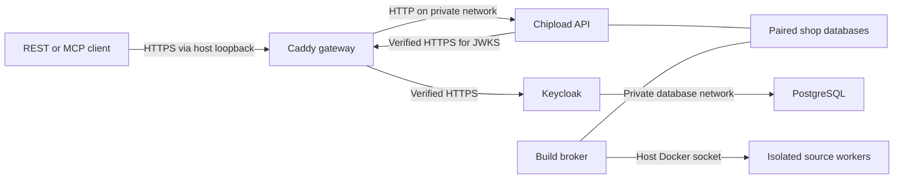

# TLS and identity containers

The TLS stack runs a Caddy gateway, production-mode Keycloak, PostgreSQL,
Chipload API, and build broker on one Linux Docker host. REST and MCP share the
same HTTPS endpoint and authorization policy. Only the gateway publishes ports;
both its client and administration listeners bind to host loopback.

This is a tested deployment building block. Public routing, production OpenBao
delivery, credential rotation, coordinated recovery, deployment load testing,
and stronger worker-host isolation remain deployment gates. Starting this stack
does not expose a public service.

## Start locally

Use Python 3.12+, `uv`, Docker Engine, and a recent Docker Compose with `!reset`
and `!override` support. Run as a non-root account with local Docker access:

```sh
uv sync --locked --extra server
./scripts/build-worker
./scripts/build-runtime
./scripts/build-tls
uv run --extra server python scripts/tls-stack init --local --shop thermal-example
uv run --extra server python scripts/tls-stack up
uv run --extra server python scripts/tls-stack status
curl --fail --cacert .local/tls/identity-ca.pem https://chipload.localhost:8443/healthz
```

The helper generates private state under `.local/tls/`, a local certificate
authority, certificates for `chipload.localhost` and `identity.localhost`, a
Keycloak service account, and an explicit Chipload grant for the selected shop.
It verifies TLS chains, hostnames, and the advertised issuer after startup.
Readiness connects through host loopback with the configured SNI/Host, so it
does not depend on changing DNS. Client commands still need those hostnames to
resolve to loopback; many local resolvers already handle `.localhost`.

No trust certificate is installed in the operating system. Each client must
explicitly trust `identity-ca.pem`. Local leaf certificates expire after seven
days and the local CA after thirty days; automatic renewal is not implemented.
The CA private key stays in `recovery/local-ca-key.pem`, outside every container
mount. Keep this local CA scoped to development.

Use `--state PATH` **before** the subcommand to manage another instance.
`init` accepts `--name`, `--port`, `--admin-port`, and `--subnet`. The default
ports are 8443 and 8444. The helper chooses a private IPv4 `/28` that does not
overlap existing Docker networks. Check host/VPN routes separately, or supply
an appropriate `--subnet`; route overlap is not detected by the helper.

The local development Keycloak/OpenBao stack in the root `compose.yaml` is a
separate instance. This TLS stack uses its own Keycloak database and credentials.
It does not mount OpenBao root, recovery, or equipment credentials.

## Connect a shop agent or REST client

`client.json` contains the issuer, MCP resource URL, subject, shop ID, and paths
to the service-account secret and CA bundle. The secret itself stays in
`secrets/agent-secret`. The generated agent gets all current shop actions
for the **one selected shop**, including observations, publication, and rollback. It receives
no access to other shops. Reduce those grants in `runtime.json` when needed.

A REST client can obtain and use a token without printing it:

```sh
uv run --extra server python - <<'PY'
import json
import ssl
from pathlib import Path
import httpx

connection = json.loads(Path('.local/tls/client.json').read_text())
trust = ssl.create_default_context(cafile=connection['ca_file'])
with httpx.Client(verify=trust, trust_env=False) as client:
    response = client.post(
        connection['issuer'] + '/protocol/openid-connect/token',
        data={
            'grant_type': 'client_credentials',
            'client_id': connection['client_id'],
            'client_secret': Path(connection['client_secret_file']).read_text(),
        },
    )
    response.raise_for_status()
    identity = client.get(
        connection['resource_url'].removesuffix('/mcp') + '/v1/identity',
        headers={'Authorization': 'Bearer ' + response.json()['access_token']},
    )
    identity.raise_for_status()
    print(identity.json())
PY
```

Use the same CA context and bearer header with an MCP HTTP client. See
[REST/MCP contracts](API.md) for source, build, publication, and discovery calls.
The automated TLS test demonstrates the whole agent workflow. Anonymous clients
can query an explicitly published shop without a token:

```sh
curl --fail --cacert .local/tls/identity-ca.pem \
  https://chipload.localhost:8443/v1/shops/thermal-example/catalog
```

The public identity listener forwards only the `chipload` realm, login resources,
and discovery paths. Master-realm and administration routes return 404 there.
Keycloak administration is available separately at
`https://identity.localhost:8444/admin/`, with initial username `admin` and the
password in `secrets/admin-password`. Keep that listener private. Health and
metrics ports are not published.

## Use deployment certificates

Provide PEM certificate chains and their matching private keys named `api.crt`,
`api.key`, `identity.crt`, and `identity.key`. Certificates must cover the two
configured DNS names. Provide a CA bundle that verifies **both** chains; it is
also the API's explicit trust bundle for identity requests.

```sh
uv run --extra server python scripts/tls-stack --state .local/site init \
  --name chipload-site --shop example \
  --api-host shop.example.com --identity-host identity.example.com \
  --port 443 --admin-port 8444 \
  --certificates /secure/chipload-certificates \
  --ca-bundle /secure/chipload-ca-bundle.pem
uv run --extra server python scripts/tls-stack --state .local/site up
```

The helper copies these inputs into private state and checks key/certificate
compatibility. Startup verifies the actual chain and hostname at each HTTPS
listener. The supplied-certificate profile rejects `.localhost` names; the
local profile requires them. Both profiles retain loopback host bindings.

Keycloak's issuer and the token audience use the configured external HTTPS URLs.
The API fetches keys from `https://IDENTITY_HOST:8443/.../certs` through the
internal gateway network, where port 8443 is fixed. Docker DNS maps that hostname
to the gateway. The different port does not change the issuer or disable TLS
hostname checks. No JWT-supplied URL or environment proxy can redirect this fetch.

## Trust and network boundaries



The application and database networks are internal Docker networks. The API has
no external network route, Docker socket, identity database password, client
secret, or TLS private key. It mounts the shop data, settings, and public CA only.
The broker has no IP network and retains the trusted host-daemon authority
described in [application containers](RUNTIME.md#enforced-boundaries). Source
workers keep their existing network, filesystem, resource, and output limits.

Caddy overwrites `X-Forwarded-For` with the connection address. Chipload trusts
only the gateway's fixed application-network IP and accepts exactly one literal
client IP from that peer. Untrusted peers cannot select a budget by supplying a
header. Uvicorn's general proxy rewriting remains disabled. IPv6 clients still
share `/64` request allowances; clients behind NAT share their peer allowance.
A new upstream proxy needs an explicit, tested trust design: the current gateway
uses its immediate connection peer.

Caddy enforces matching TLS SNI and Host, 32 KB headers, 3 MiB API bodies, 1 MiB
identity bodies, and connection/read/write deadlines. It disables its admin API
and automatic certificate acquisition. Gateway-to-Keycloak HTTPS verifies the
configured CA and DNS name. Keycloak uses an optimized production build, fixed
hostnames, HTTPS, and exact gateway trust as described in its
[reverse-proxy guide](https://www.keycloak.org/server/reverseproxy).
The gateway settings follow Caddy's
[proxy](https://caddyserver.com/docs/caddyfile/directives/reverse_proxy) and
[server](https://caddyserver.com/docs/caddyfile/options) configuration contracts.

All five containers run non-root with read-only root filesystems, dropped Linux
capabilities, no privilege escalation, memory/CPU/process bounds, and rotating
local logs. Images are pinned; startup checks the API/broker/worker fingerprints
and the gateway/Keycloak build inputs. The gateway image removes Caddy's unused
low-port file capability because it listens on unprivileged container ports.
Gateway-to-API and Keycloak-to-PostgreSQL traffic remains plaintext inside the
single host's private networks. This topology is not a multi-host encryption or
host-compromise boundary. Docker administrators control these services.

## Preserve and operate the deployment

```sh
uv run --extra server python scripts/tls-stack logs
uv run --extra server python scripts/tls-stack down
uv run --extra server python scripts/tls-stack up
```

`down` preserves state and the named PostgreSQL volume. `init` refuses existing
state or containers/volumes with the selected project name; it never silently
replaces credentials for an existing database. Keep deployment state, Keycloak
data, and the paired Chipload databases together in a protected recovery plan.
Follow [shop storage recovery](AUTHORING.md#storage-authorization-and-recovery).
Coordinated backup/restore automation across these services is still required.

State directories are owner-only. Certificates, grants, realm import, client
configuration, and most secret files must also be owner-only. `db-password` is
0444 inside its 0700 parent so the PostgreSQL image's distinct UID can read its
individual read-only mount; the directory itself is never shared with that
container. Startup rejects widened permissions, symlinks, and mismatched keys.
Do not put state outside an ignored/protected location or commit it.

To install renewed certificates, replace the four certificate/key files and
CA bundle in state while preserving permissions, then run `tls-stack reload`.
It recreates gateway, Keycloak, and API, and verifies their HTTPS endpoints.
Plan a maintenance interruption and distribute a changed CA to clients first.
The live test exercises replacement of both certificates and CA trust while
preserving identities and grants, and rejects clients that retain only the old
CA. Automatic renewal and identity/database credential rotation remain work.

Keycloak imports a realm only when absent. Editing `realm.json` or an initial
secret file does **not** update existing users, clients, or database passwords.
Make identity changes through authenticated Keycloak administration and update
Chipload's explicit subject bindings separately. Issuer/hostname changes also
require deliberate client and audience migration. `up` does not perform that
migration. The bootstrap admin should be replaced by managed operator accounts
as part of production identity setup.

## Verify

```sh
CHIPLOAD_TLS_TESTS=1 uv run --extra server python -m unittest discover -s tests -p 'test_tls_live.py' -v
```

These opt-in tests use fresh credentials, certificates, data, and temporary
Compose projects. They verify real Keycloak tokens, TLS chain/name checks, REST
and official MCP interoperability, isolated builds, publication/update/rollback,
restart persistence, withdrawal, cross-shop denial, hidden administration,
request bounds, and forwarded-header spoofing resistance. They also check actual
mounts, capabilities, exposed ports, and API network denial. Untrusted identity
TLS fails authenticated requests while existing public discovery stays usable.
The supplied-certificate profile is exercised with new CA/certificate delivery
through `reload`, followed by fresh authenticated requests. Only resources
belonging to each test are removed.
