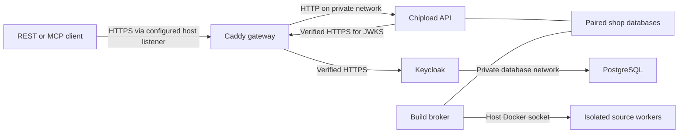

# TLS and identity containers

The TLS stack runs a Caddy gateway, production-mode Keycloak, PostgreSQL,
Chipload API, and build broker on one Linux Docker host. REST and MCP share the
same HTTPS endpoint and authorization policy. Only the gateway publishes ports.
Client traffic defaults to host loopback and can use an explicitly configured
IPv4 address with supplied deployment certificates. Administration always binds
to `127.0.0.1`.

This is a tested deployment building block. Site DNS/firewall routing, automatic
certificate renewal, production OpenBao delivery, operator-account lifecycle,
off-host disaster recovery, deployment load testing and stronger worker-host
isolation remain deployment gates. The default configuration stays local.

## Start locally

Use Python 3.12+, `uv`, Docker Engine, and a recent Docker Compose with `!reset`
and `!override` support. Run as a non-root account with local Docker access:

```sh
uv sync --locked --extra server
./scripts/build-worker
./scripts/build-runtime
./scripts/build-tls
uv run --extra server python scripts/tls-stack init --local --shop thermal-example
uv run --extra server python scripts/tls-stack up
uv run --extra server python scripts/tls-stack status
curl --fail --cacert .local/tls/identity-ca.pem https://chipload.localhost:8443/healthz
```

The helper generates private state under `.local/tls/`, a local certificate
authority, certificates for `chipload.localhost` and `identity.localhost`, a
Keycloak service account, and an explicit Chipload grant for the selected shop.
It verifies TLS chains, hostnames, and the advertised issuer after startup.
Readiness connects to the configured local listener with the configured SNI/Host, so it
does not depend on changing DNS. Client commands still need those hostnames to
resolve to loopback; many local resolvers already handle `.localhost`.

No trust certificate is installed in the operating system. Each client must
explicitly trust `identity-ca.pem`. Local leaf certificates expire after seven
days and the local CA after thirty days; automatic renewal is not implemented.
The CA private key stays in `recovery/local-ca-key.pem`, outside every container
mount. Keep this local CA scoped to development.

Use `--state PATH` **before** the subcommand to manage another instance.
`init` accepts `--name`, `--port`, `--admin-port`, and `--subnet`. The default
ports are 8443 and 8444. The helper chooses a private IPv4 `/28` that does not
overlap existing Docker networks. Check host/VPN routes separately, or supply
an appropriate `--subnet`; route overlap is not detected by the helper.

The local development Keycloak/OpenBao stack in the root `compose.yaml` is a
separate instance. This TLS stack uses its own Keycloak database and credentials.
It does not mount OpenBao root, recovery, or equipment credentials.

## Connect a shop agent or REST client

`client.json` contains the issuer, MCP resource URL, subject, shop ID, and paths
to the service-account secret and CA bundle. The secret itself stays in
`secrets/agent-secret`. The generated agent gets all current shop actions
for the **one selected shop**, including observations, publication, and rollback. It receives
no access to other shops. Reduce those grants in `runtime.json` when needed.

A REST client can obtain and use a token without printing it:

```sh
uv run --extra server python - <<'PY'
import json
import ssl
from pathlib import Path
import httpx

connection = json.loads(Path('.local/tls/client.json').read_text())
trust = ssl.create_default_context(cafile=connection['ca_file'])
with httpx.Client(verify=trust, trust_env=False) as client:
    response = client.post(
        connection['issuer'] + '/protocol/openid-connect/token',
        data={
            'grant_type': 'client_credentials',
            'client_id': connection['client_id'],
            'client_secret': Path(connection['client_secret_file']).read_text(),
        },
    )
    response.raise_for_status()
    identity = client.get(
        connection['resource_url'].removesuffix('/mcp') + '/v1/identity',
        headers={'Authorization': 'Bearer ' + response.json()['access_token']},
    )
    identity.raise_for_status()
    print(identity.json())
PY
```

Use the same CA context and bearer header with an MCP HTTP client. See
[REST/MCP contracts](API.md) for source, build, publication, and discovery calls.
The automated TLS test demonstrates the whole agent workflow. Anonymous clients
can query an explicitly published shop without a token:

```sh
curl --fail --cacert .local/tls/identity-ca.pem \
  https://chipload.localhost:8443/v1/shops/thermal-example/catalog
```

The public identity listener forwards only the `chipload` realm, login resources,
and discovery paths. Master-realm and administration routes return 404 there.
Keycloak administration is available separately at
`https://identity.localhost:8444/admin/`, with initial username `admin` and the
password in `secrets/admin-password`. Keep that listener private. Health and
metrics ports are not published.

## Use deployment certificates

Provide PEM certificate chains and their matching private keys named `api.crt`,
`api.key`, `identity.crt`, and `identity.key`. Certificates must cover the two
configured DNS names. Provide a CA bundle that verifies **both** chains; it is
also the API's explicit trust bundle for identity requests.

```sh
uv run --extra server python scripts/tls-stack --state .local/site init \
  --name chipload-site --shop example \
  --api-host shop.example.com --identity-host identity.example.com \
  --port 443 --admin-port 8444 \
  --certificates /secure/chipload-certificates \
  --ca-bundle /secure/chipload-ca-bundle.pem
uv run --extra server python scripts/tls-stack --state .local/site up
```

The helper copies these inputs into private state and checks key/certificate
compatibility. Startup verifies the actual chain and hostname at each HTTPS
listener. The supplied-certificate profile rejects `.localhost` names; the
local profile requires them. Both profiles default to loopback host bindings.

Keycloak's issuer and the token audience use the configured external HTTPS URLs.
The API fetches keys from `https://IDENTITY_HOST:8443/.../certs` through the
internal gateway network, where port 8443 is fixed. Docker DNS maps that hostname
to the gateway. The different port does not change the issuer or disable TLS
hostname checks. No JWT-supplied URL or environment proxy can redirect this fetch.

## Configure a public client listener

On a deployment with supplied certificates, add `--listen-address ADDRESS` to
`init`. A specific IPv4 address binds only that host address; `0.0.0.0` binds all
host IPv4 addresses. The local-certificate profile rejects non-loopback binding.
Existing deployment state without this setting continues to use `127.0.0.1`.
Helper commands read this setting from deployment JSON, overriding any inherited
environment value.

```sh
uv run --extra server python scripts/tls-stack --state .local/public-site init \
  --name chipload-public-site --shop example \
  --api-host shop.example.com --identity-host identity.example.com \
  --listen-address 0.0.0.0 --port 443 --admin-port 8444 \
  --certificates /secure/chipload-certificates \
  --ca-bundle /secure/chipload-ca-bundle.pem
uv run --extra server python scripts/tls-stack --state .local/public-site up
```

This configuration exposes the client port when started. Point both DNS names
at the deployment and permit the client TCP port through the site's network
controls. Keep the administration port private; it is still published only on
loopback. API, broker, database and Keycloak service ports are not published.
The helpers reach a specific bind address directly, or loopback for a wildcard
bind, while verifying the configured TLS name. Administrative requests always
connect through loopback.

Starting a non-loopback listener requires Docker Engine 28 or later. Verify the
actual host/network firewall path.
Docker installs port-publishing rules, and older releases have different
loopback-isolation behavior; see [Docker port publishing](https://docs.docker.com/engine/network/port-publishing/).
The tested path uses direct IPv4 clients. IPv6 listener bindings, upstream HTTP
proxies/CDNs and Docker direct-routing configurations need a separate verified
trust design. Do not enable forwarded-header trust for an unverified upstream.

The external-client drill runs on a separate Docker network without source NAT
and binds the gateway to a test bridge's host address. It verifies REST/MCP
discovery, verified TLS, private-source refusal, inaccessible administration and
direct API ports, and distinct client request budgets despite forged forwarding
headers. Clients behind a shared NAT retain a shared peer budget. This establishes
routing and authorization behavior on the test host; it does not establish WAN
reachability, certificate renewal or sustained-load capacity for another deployment.

```sh
CHIPLOAD_TLS_TESTS=1 uv run --extra server python -m unittest discover -s tests -p 'test_edge_live.py' -v
```

## Trust and network boundaries



The application and database networks are internal Docker networks. The API has
no external network route, Docker socket, identity database password, client
secret, or TLS private key. It mounts the shop data, settings, and public CA only.
The broker has no IP network and retains the trusted host-daemon authority
described in [application containers](RUNTIME.md#enforced-boundaries). Source
workers keep their existing network, filesystem, resource, and output limits.

Caddy overwrites `X-Forwarded-For` with the connection address. Chipload trusts
only the gateway's fixed application-network IP and accepts exactly one literal
client IP from that peer. Untrusted peers cannot select a budget by supplying a
header. Uvicorn's general proxy rewriting remains disabled. IPv6 clients still
share `/64` request allowances; clients behind NAT share their peer allowance.
A new upstream proxy needs an explicit, tested trust design: the current gateway
uses its immediate connection peer.

Caddy enforces matching TLS SNI and Host, 32 KB headers, 3 MiB API bodies, 1 MiB
identity bodies, and connection/read/write deadlines. It disables its admin API
and automatic certificate acquisition. Gateway-to-Keycloak HTTPS verifies the
configured CA and DNS name. Keycloak uses an optimized production build, fixed
hostnames, HTTPS, and exact gateway trust as described in its
[reverse-proxy guide](https://www.keycloak.org/server/reverseproxy).
The gateway settings follow Caddy's
[proxy](https://caddyserver.com/docs/caddyfile/directives/reverse_proxy) and
[server](https://caddyserver.com/docs/caddyfile/options) configuration contracts.

All five containers run non-root with read-only root filesystems, dropped Linux
capabilities, no privilege escalation, memory/CPU/process bounds, and rotating
local logs. Images are pinned; startup checks the API/broker/worker fingerprints
and the gateway/Keycloak build inputs. The gateway image removes Caddy's unused
low-port file capability because it listens on unprivileged container ports.
Gateway-to-API and Keycloak-to-PostgreSQL traffic remains plaintext inside the
single host's private networks. This topology is not a multi-host encryption or
host-compromise boundary. Docker administrators control these services.

## Preserve and operate the deployment

```sh
uv run --extra server python scripts/tls-stack logs
uv run --extra server python scripts/tls-stack down
uv run --extra server python scripts/tls-stack up
```

`down` preserves state and the named PostgreSQL volume. `init` refuses existing
state or containers/volumes with the selected project name; it never silently
replaces credentials for an existing database. Keep deployment state, Keycloak
data, and the paired Chipload databases together in a protected recovery plan.
Follow [shop storage recovery](AUTHORING.md#storage-authorization-and-recovery).
The [encrypted recovery workflow](RECOVERY.md) coordinates backups of these
services and restores into fresh state with startup blocked until completion.
It includes an interruption/retry drill; off-host recovery and OpenBao recovery
remain separate operational requirements.

State directories are owner-only. Certificates, grants, realm import, client
configuration, and most secret files must also be owner-only. `db-password` is
0444 inside its 0700 parent so the PostgreSQL image's distinct UID can read its
individual read-only mount; the directory itself is never shared with that
container. Startup rejects widened permissions, symlinks, and mismatched keys.
Do not put state outside an ignored/protected location or commit it.

To install renewed certificates, replace the four certificate/key files and
CA bundle in state while preserving permissions, then run `tls-stack reload`.
It recreates gateway, Keycloak, and API, and verifies their HTTPS endpoints.
Plan a maintenance interruption and distribute a changed CA to clients first.
The live test exercises replacement of both certificates and CA trust while
preserving identities and grants, and rejects clients that retain only the old
CA. Automatic certificate renewal remains work. Use the
[credential rotation helper](CREDENTIALS.md) for the provisioned shop-agent secret
and Keycloak database password, including interruption and retry. The helper also
rotates the realm's RS256 signing key with a recorded verification overlap and a
separate retirement command that clears the API key cache. Signing-key rotation
and HTTPS certificate renewal are separate operations.

Keycloak imports a realm only when absent. Editing `realm.json` or an initial
secret file does **not** update existing users, clients, or database passwords.
Make identity changes through authenticated Keycloak administration and update
Chipload's explicit subject bindings separately. Issuer/hostname changes also
require deliberate client and audience migration. `up` does not perform that
migration. The bootstrap admin should be replaced by managed operator accounts
as part of production identity setup.

## Verify

```sh
CHIPLOAD_TLS_TESTS=1 uv run --extra server python -m unittest discover -s tests -p 'test_tls_live.py' -v
```

These opt-in tests use fresh credentials, certificates, data, and temporary
Compose projects. They verify real Keycloak tokens, TLS chain/name checks, REST
and official MCP interoperability, isolated builds, publication/update/rollback,
restart persistence, withdrawal, cross-shop denial, hidden administration,
request bounds, and forwarded-header spoofing resistance. They also check actual
mounts, capabilities, exposed ports, and API network denial. Untrusted identity
TLS fails authenticated requests while existing public discovery stays usable.
The supplied-certificate profile is exercised with new CA/certificate delivery
through `reload`, followed by fresh authenticated requests. Only resources
belonging to each test are removed.

## Measure the deployed path

Build the worker, runtime and TLS images, then run:

```sh
uv run --extra server python scripts/benchmark-deployment --seconds 150 --require-success
uv run --extra server python scripts/benchmark-deployment --seconds 60 --noise-rate 60 --require-success
uv run --extra server python scripts/benchmark-deployment --seconds 60 --readers 4 --rate 20 --policy capacity
```

Each command creates its own five-service TLS deployment, supplied test
certificates, identity database, shop storage and routed client network. It binds
only the temporary bridge's host address. Separate client containers preserve
their actual source addresses and verify the gateway's certificate and hostname.
The script has no option to target an existing deployment. It removes only its
own containers, network, volume and temporary state. Run it as a non-root account
with Docker access; Docker Engine 28 or later is required.

The fixture is the exported three-axis milling Python project, including its
technical and business acceptance cases. The script saves, builds and publishes
it through the actual API and broker, then installs fresh simulated observations.
Readers alternate REST and MCP across catalog and capability pages, all four
evaluation outcomes, and prototype business conditions. Every successful result
must identify the expected public revision and satisfy its known fixture facts.
The fixture's private equipment address must stay absent. This is simulated shop
data, not qualification of a manufacturing process.

Half the readers authenticate with real Keycloak service-account tokens. Each
authenticated client acquires its own token through HTTPS and refreshes it during
longer runs; all those clients share one subject's allowance. Token-acquisition
latency is recorded separately and also contributes to any request that needs
it. The other readers remain anonymous. Persistent HTTP/1.1 connections include
their initial TLS handshake; the workload does not open a fresh connection for
every request or measure HTTP/2 performance.

During discovery traffic, another client uses MCP `run_python` to read and edit
the project and request a build. Its draft changes the shop name. Discovery must
keep returning the original publication. After load stops, the controller
publishes the completed draft, checks its new name, rolls back, and checks the
original catalog. It also checks that service containers remain running without
an OOM kill or restart. The report states whether authoring completed during the
measurement window; a short window cannot establish that by assumption.

`--rate` is the scheduled request rate per reader. A client has at most one
request in flight and skips missed slots instead of creating a growing queue or
catch-up burst. Missed slots are reported separately from attempted requests;
successful throughput uses the entire measurement window. This bounds client
load and makes failure to sustain the offered schedule visible. Each request has
an eight-second socket timeout; no failed mutation is automatically replayed.
Only inspections of the existing author run/build are polled again after a
retryable refusal. The admission call itself is never silently resubmitted.

`--policy defaults` retains shipped request and mutation limits. `capacity`
raises deployment, peer and identity HTTP allowances **only in the disposable
fixture**, leaving mutation, source, build, Python and container limits intact.
`--noise-rate` adds a distinct anonymous peer sending invalid bearer tokens and
changing forged forwarding headers. Its authentication denials and throttling
are reported separately from useful discovery work. This is a bounded adversarial
traffic fixture, not a distributed denial-of-service test.

JSON output records effective policy, image IDs, container limits, fixture size,
checkout and client-source digest, per-client results, HTTP and MCP service
statuses, token requests, successful throughput, successful median/p95 latency,
missed slots and authoring time. MCP errors carried in HTTP 200 responses and
wrong domain answers never count as successful work. Credentials and returned
private source are excluded. Progress goes to stderr so stdout can be saved as
one JSON report.

Unexpected failures or wrong answers fail the command. Ordinary 429/503
backpressure remains visible in a capacity measurement. `--require-success`
additionally requires every reader request and scheduled slot to succeed and
authoring to finish within the load window. Compare the offered rate, success
ratio and missed slots alongside latency; fast refusals are not useful throughput.

This measures a single Linux host, a compact shop, local routed networks, TLS,
identity verification, discovery and concurrent authoring. WAN latency,
independent tenant fairness, larger shops, equipment adapters, certificate
renewal and long-running operational reliability require further qualification.

### Recorded measurements

On 2026-10-21 UTC, a shared Linux x86-64 host with 16 logical CPUs and Docker
29.8.1 produced the following results. API and gateway retained their one-CPU
limits; the five service images and other limits are recorded in the linked JSON
reports. The source bundle was 134,630 bytes with 24 acceptance cases. These
measurements were taken during development; reports retain the checkout, dirty
worktree flag and exact client-source digest.

| Workload | Window | Scheduled reader requests/s | Correct results / attempts | Missed reader slots | Correct results/s | Successful p95 | Author completed |
| --- | ---: | ---: | ---: | ---: | ---: | ---: | ---: |
| [Defaults](benchmarks/deployment-defaults.json) | 150 s | 10 | 1,497 / 1,497 | 3 | 9.98 | 56 ms | 7.33 s |
| [Defaults with invalid-token traffic, first run](benchmarks/deployment-noise-initial.json) | 60 s | 10 | 597 / 600 | 0 | 9.95 | 76 ms | 11.98 s |
| [Defaults with invalid-token traffic, repeat](benchmarks/deployment-noise.json) | 60 s | 10 | 600 / 600 | 0 | 10.00 | 58 ms | 7.33 s |
| [Capacity policy](benchmarks/deployment-capacity.json) | 60 s | 80 | 2,780 / 2,801 | 1,999 | 46.33 | 59 ms | 8.39 s |

All completed domain answers were correct. Publications stayed unchanged during
draft work, post-load publication/rollback succeeded, and no service container
restarted or reported an OOM kill. The 150-second run exercised token refresh
successfully. Its slowest response took 761 ms, causing three missed reader slots.
The first invalid-token run returned three HTTP 503 responses to readers;
its separate noisy peer received 1,242 authentication denials, 1,537 rate limits
and two admission-capacity refusals. It attempted 2,781 of 3,600 scheduled noisy
requests; the generator's remaining slots were missed, not sent.

The repeat passed its strict reader check while the noisy peer received 1,238
authentication denials and 2,243 rate limits across 3,481 attempts. That generator
missed 119 slots. The earlier refusals remain in the recorded evidence; one clean
repeat does not establish consistent availability. The completed decoder also
preserves MCP ingress-refusal details that the first report labeled `http_error`.

The capacity probe returned 21 service refusals: twenty `data_busy` and one
`request_capacity`. Eleven were MCP failures inside HTTP 200 responses. Its
slowest successful response took 1.33 seconds. The offered 80 requests/s was
not sustained: neither the reported successful p95 nor the process exit status
should conceal those refused requests and missed slots.

The initial regression target for the default and bounded-noise fixtures is
every scheduled reader slot succeeding at 10 requests/s, successful p95 below
100 ms, authoring within 30 seconds, and preserved publication/rollback checks.
The strict zero-miss/refusal target is **not consistently met** by these measurements.
Admission contention and long-tail responses require further work. The capacity
probe reports overload behavior; it has no claim of sustaining the offered rate.
These are development targets for this fixture and comparable hardware, not a
production SLA.
